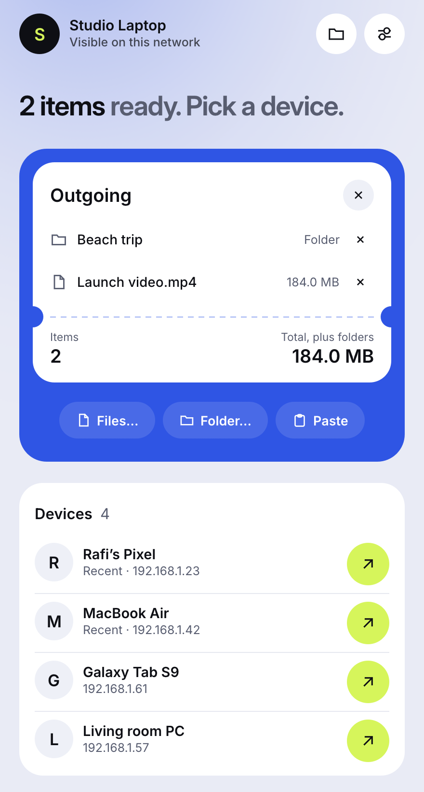
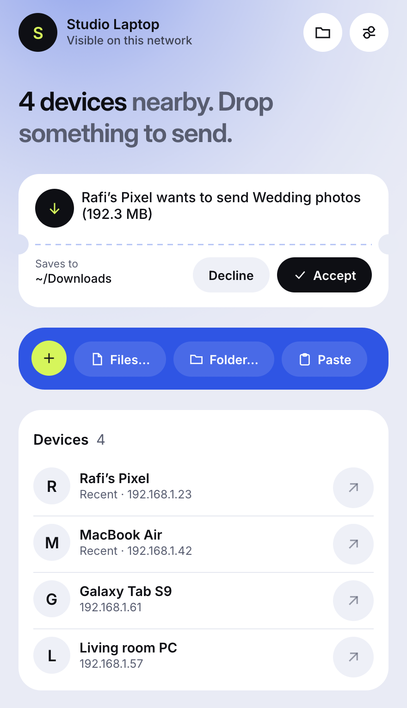
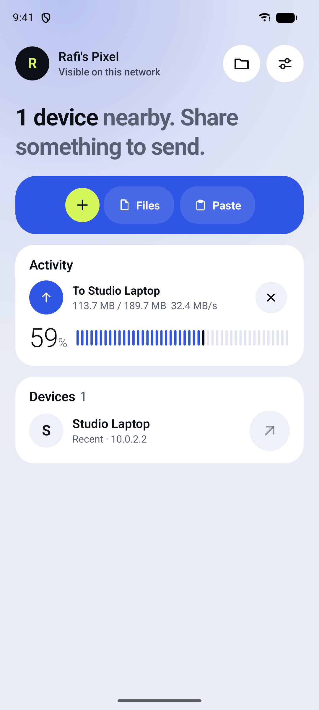

<div align="center">


# FlashHop

**Send files between your devices like they're in the same room.**<br>
Linux, macOS, Windows, and Android, over your own Wi‑Fi. No internet, no account, no cloud.

[](https://github.com/kayesFerdous/FlashHop/releases/latest/download/flashhop-android.apk)
[](https://github.com/kayesFerdous/FlashHop/releases/latest/download/flashhop-windows-x86_64.zip)
[](https://github.com/kayesFerdous/FlashHop/releases/latest/download/flashhop-macos.zip)
[](https://github.com/kayesFerdous/FlashHop/releases/latest/download/flashhop-linux-x86_64.tar.gz)

<br>

&nbsp;&nbsp;
&nbsp;&nbsp;


<sub><b>1.</b> Drop files and pick a device &nbsp;·&nbsp; <b>2.</b> The other side taps Accept &nbsp;·&nbsp; <b>3.</b> It arrives at full network speed</sub>

</div>

## Install

**macOS / Linux**

```bash
curl -fsSL https://raw.githubusercontent.com/kayesFerdous/FlashHop/main/install.sh | sh
```

**Windows** (PowerShell)

```powershell
irm https://raw.githubusercontent.com/kayesFerdous/FlashHop/main/install.ps1 | iex
```

**Android 11+**: download [flashhop-android.apk](https://github.com/kayesFerdous/FlashHop/releases/latest/download/flashhop-android.apk), open it, and allow "install unknown apps".

<details>
<summary>Manual downloads and uninstalling</summary>
<br>

| Platform | File | First run |
|---|---|---|
| macOS 11+ (Intel + Apple Silicon) | [flashhop-macos.zip](https://github.com/kayesFerdous/FlashHop/releases/latest/download/flashhop-macos.zip) | Move it to Applications. It isn't signed by Apple, so on first open go to System Settings → Privacy & Security → **Open Anyway**. (`install.sh` skips this step.) |
| Windows 10/11 x64 | [flashhop-windows-x86_64.zip](https://github.com/kayesFerdous/FlashHop/releases/latest/download/flashhop-windows-x86_64.zip) | Unzip and run `flashhop.exe`. Click **Allow** when Windows Firewall asks. |
| Linux x86_64 | [flashhop-linux-x86_64.tar.gz](https://github.com/kayesFerdous/FlashHop/releases/latest/download/flashhop-linux-x86_64.tar.gz) | `tar xzf flashhop-linux-x86_64.tar.gz && ./flashhop` |

Uninstall: `curl -fsSL https://raw.githubusercontent.com/kayesFerdous/FlashHop/main/install.sh | sh -s -- --uninstall` on macOS/Linux, or
`& ([scriptblock]::Create((irm https://raw.githubusercontent.com/kayesFerdous/FlashHop/main/install.ps1))) -Uninstall` on Windows.
All versions are on the [releases page](https://github.com/kayesFerdous/FlashHop/releases).

</details>

## Why FlashHop

- **Fast.** Bytes go straight from one device to the other over TCP, with zero-copy `sendfile` on Linux and Android. No server in the middle.
- **Private.** Nothing leaves your router. There's no sign-up and no telemetry.
- **Paste anything.** Press Ctrl+V (Cmd+V on a Mac) to send copied files, screenshots, or text. Text and images land on the other device's clipboard.
- **Small.** The desktop app is a single ~9 MB binary, and the APK is ~1 MB.
- **One engine.** Every app runs the same Rust core, so they behave identically.

## How to use

1. Open FlashHop on both devices. They find each other within a couple of seconds.
2. **Desktop:** drop files or folders on the window, use **Files…** / **Folder…**, or paste. **Android:** tap **Share → FlashHop** in any app, or use **Files** / **Paste**.
3. Tap the lime arrow next to a device. The receiver gets a notification and taps **Accept**.

Files land in `~/Downloads` (desktop) or `Download/FlashHop` (Android). You can change either in Settings.

> [!NOTE]
> All devices must be on the same network, and port **47821** (UDP + TCP) must be allowed through any firewall, e.g. `sudo ufw allow 47821` on Linux.

<details>
<summary><b>Build from source</b></summary>
<br>

```bash
cargo run --release -p flashhop     # desktop app
cargo test --workspace              # protocol test: folder + text + fd, path-traversal checks
```

Android needs the Android SDK, NDK, and a JDK. It doesn't use Gradle; `build.sh` calls the SDK tools directly and takes about 15 seconds.

```bash
android/setup-tools.sh   # once: Rust Android targets + kotlinc in ~/.local/share/flashhop-android
android/build.sh         # -> android/flashhop.apk
adb install -r android/flashhop.apk
```

No second device? `core/examples/peer.rs` is a headless peer that runs the same engine and accepts every offer:

```bash
cargo run --release -p flashhop_core --example peer -- recv /tmp/inbox
cargo run --release -p flashhop_core --example peer -- send 192.168.1.50:47821 ./folder "text:hello"
```

</details>

<details>
<summary><b>How it works</b></summary>
<br>

```
core/            shared Rust engine: wire protocol (net.rs), discovery, offers, transfers,
                 progress, file naming, every message text. No dependencies.
desktop/         egui window (Linux, macOS, Windows)
android/rust/    thin JNI bridge
android/src/     Kotlin screens, plain Android widgets
```

- **Discovery:** every 2 seconds, each device broadcasts its name over UDP, and devices that hear it reply directly.
- **Transfer:** one TCP connection per send: a header, then accept/decline, then raw bytes.
- **Safety:** every incoming path is checked, so a sender can't write outside your downloads folder. The protocol is versioned, so mismatched builds refuse each other instead of corrupting files.

</details>

<details>
<summary><b>Not done yet</b></summary>
<br>

- **No encryption.** That's fine on a home network but not on public Wi‑Fi. TLS with a pairing code is next.
- Android receives only while the app is open, and sends files but not whole folders.
- Empty folders aren't sent. There's no tray icon and no auto-accept for trusted devices.

</details>
